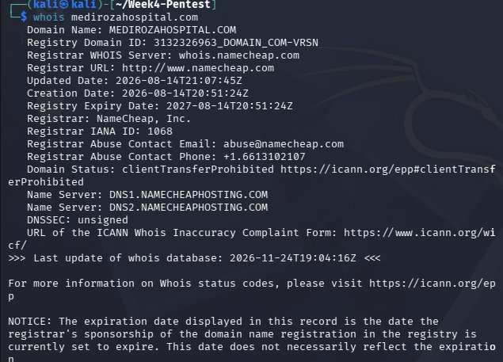

# Mediroza General Hospital – Web Application Security Assessment


**Networkwalks | Week 4 Cybersecurity Project | Batch B083**

[]()
[]()
[]()

## 1. Project Overview

This repository contains the documentation and selected reconnaissance evidence for the Networkwalks Week 4 cybersecurity project: a black-box web application security assessment of **Mediroza General Hospital**.

The assessment report documents a structured review of the target's publicly accessible web infrastructure, including domain reconnaissance, DNS enumeration, service identification, web application inspection, vulnerability identification, risk assessment, and remediation recommendations.

The purpose of the project was to understand how security weaknesses in a web application and its hosting environment can expose sensitive information and affect the confidentiality, integrity, and availability of information systems.

## 2. Assessment Information

| Item | Details |
|---|---|
| Project | Networkwalks Week 4 |
| Target Organisation | Mediroza General Hospital |
| Target Website | https://medirozahospital.com |
| Assessment Type | Black-Box Web Application Security Assessment |
| Assessment Scope | Target domain only |
| Methodology | Structured testing aligned with the OWASP Testing Guide |
| Programme | Networkwalks |
| Batch | B083 |
| Report Version | 1.0 – Final |
| Report Classification | Confidential |

## 3. Assessment Scope and Rules of Engagement

According to the report, the assessment was limited to:

`medirozahospital.com`

The documented rules of engagement specified:

- No social engineering.
- No Denial-of-Service testing.
- No testing outside the agreed scope.
- Written authorisation was stated in the report.

The assessment report describes both passive and active reconnaissance, vulnerability identification, technical analysis, and reporting activities.

## 4. Assessment Methodology

The report describes the following five assessment phases:

### Phase 1 – Passive Reconnaissance

Collection of publicly available information about the target, including:

- WHOIS information.
- DNS records.
- IP address and hosting information.
- Publicly available domain information.

### Phase 2 – Active Reconnaissance

The report documents service and technology identification, including:

- Port and service identification.
- Web Application Firewall detection.
- Website technology fingerprinting.
- Review of publicly accessible website paths and resources.

### Phase 3 – Vulnerability Identification

The assessment report documents a review of:

- Web application authentication.
- Input handling.
- Directory configuration.
- Publicly accessible files.
- Application error handling.

### Phase 4 – Exploitation and Impact Assessment

The report describes exploitation activities intended to demonstrate the potential impact of the identified weaknesses. It documents reported access to restricted application resources and exposure of sensitive files.

Sensitive patient and employee information is deliberately not reproduced in this repository.

### Phase 5 – Reporting and Remediation

The final phase involved documenting the reported vulnerabilities, assigning severity ratings, describing potential impacts, and recommending corrective actions.

## 5. Tools Documented

The following tools are listed in the assessment report:

| Tool | Documented Purpose |
|---|---|
| Nmap | Port scanning and service version detection |
| WAFW00F | Web Application Firewall detection |
| WhatWeb | Web technology fingerprinting |
| Gobuster | Directory and file enumeration |
| Burp Suite | HTTP traffic interception and analysis |
| cURL | HTTP header and response inspection |
| pdfcrack | PDF password recovery analysis |
| John the Ripper | Offline hash analysis |
| ExifTool | File metadata analysis |
| Web Browser | Manual web application exploration |

## 6. Summary of Reported Findings

The report documents seven security findings.

| No. | Finding | CVSS Score | Severity |
|---|---|---:|---|
| 1 | SQL Injection – Patient Portal Authentication Bypass | 9.8 | Critical |
| 2 | Exposed Database Backup File | 9.1 | Critical |
| 3 | Weak PDF Encryption Passwords | 7.5 | High |
| 4 | Sensitive Path Disclosure via robots.txt | 5.3 | Medium |
| 5 | Directory Listing Enabled | 5.3 | Medium |
| 6 | Username Enumeration on Login Form | 5.3 | Medium |
| 7 | Verbose SQL Error Messages | 3.1 | Low |

*Severity scores and descriptions above are reproduced from the assessment report. They have not been independently validated in this repository.*

## 7. Key Security Observations

The report highlights several areas requiring security attention:

- **Authentication security:** The patient portal was reported to have an SQL injection vulnerability and username enumeration behaviour.
- **Sensitive file exposure:** The report describes a publicly accessible database backup.
- **Document protection:** The report identifies weak passwords protecting patient PDF documents.
- **Information disclosure:** Publicly accessible configuration information and directory listings were reported.
- **Error handling:** Detailed database error messages were reported as visible to users.

Together, these findings illustrate how multiple weaknesses can increase the risk of unauthorised access and sensitive information exposure.

## 8. Remediation Recommendations

The assessment report recommends the following security improvements:

### Immediate Priorities

- Replace unsafe database queries with parameterised queries and prepared statements.
- Remove publicly accessible database backup files and store backups securely.
- Disable detailed PHP and database error messages in production environments.

### Short-Term Priorities

- Enforce strong passwords for protected documents.
- Review publicly exposed paths in `robots.txt`.
- Use consistent authentication error messages to reduce username enumeration.

### Medium-Term Priorities

- Disable directory listing across web server directories.
- Review and properly configure Web Application Firewall protections.
- Audit hosted files for accidental exposure.
- Implement multi-factor authentication for patient and staff portals.
- Apply the principle of least privilege.

### Long-Term Security Improvements

- Conduct regular security assessments.
- Adopt a Secure Development Lifecycle.
- Provide security awareness training.
- Establish and maintain an incident response plan.

## 9. Evidence and Screenshots

The following screenshots provide selected supporting evidence for the reconnaissance activities documented in the report.

### 9.1 DNS A Record


### 9.2 DNS MX Records


### 9.3 DNS NS Records


### 9.4 Reconnaissance



## 10. Full Assessment Report

The complete assessment report is available in this repository:

[**View the Mediroza Hospital Penetration Testing Report (PDF)**](<Mediroza Hospital Pen reports By Nizamaddeen Umar.pdf>)

The PDF contains the detailed assessment narrative, technical findings, evidence figures, remediation summary, and appendices.

## 11. Repository Structure

All project files are stored directly in the repository root.

```text
Networkwalks-Week4-Penetration-Testing/
│
├── README.md
├── networkwalks-logo.png
├── dig A.PNG
├── dig mx.PNG
├── dig ns.PNG
├── recon.PNG
└── Mediroza Hospital Pen reports By Nizamaddeen Umar.pdf
```

## 12. Ethical Considerations and Confidentiality

This project is presented as an educational cybersecurity assessment.

The accompanying report is marked **CONFIDENTIAL – AUTHORISED PERSONNEL ONLY**. Therefore, the complete report and supporting evidence should only be shared with people authorised to access them.

Before publishing this repository publicly:

- Remove or redact patient names, medical records, patient identifiers, and test results.
- Remove staff personal information, national identification numbers, salaries, and shareholder details.
- Do not publish passwords, credentials, database contents, or other confidential information.
- Do not include sensitive exploit material or private access details.
- Confirm that the material being published is authorised for public disclosure.

## 13. Disclaimer

This repository documents findings as presented in the accompanying assessment report. It does not represent an independent verification of the target's current security condition.

The report's findings and severity ratings should be understood as assessment-reported results, not as confirmation that the vulnerabilities remain present.

This project does not imply an affiliation with or endorsement by Mediroza General Hospital.

---

**Project:** Networkwalks Week 4 – Web Application Security Assessment  
**Programme:** Networkwalks  
**Batch:** B083  
**Report:** Mediroza Hospital Pen reports By Nizamaddeen Umar  
**Version:** 1.0 – Final
